# Uranium Prospectivity Mapping - South Pass / Granite Mountains, Wyoming (pilot)

A CPU-only, crash-safe machine-learning pipeline that ranks every 50 m cell of an 8,630 km² area by how closely its radiometric,
geological and structural surroundings resemble those of 199 known uranium occurrences, plus a web map that shows the ranking and
the evidence behind it. Public data only. **A learning and portfolio pilot: it ranks areas worth a closer look. It does not discover
deposits and must not be used for drilling, investment or land decisions.**

- **Live demo:** https://mpm-serve-128504750100.us-central1.run.app (Google Cloud Run, free-trial account; **the service stops on
  2026-12-17 unless the account is upgraded**, so it may be offline when you read this).
- **Owner and how it was built:** see [docs/PROJECT_OVERVIEW.md](docs/PROJECT_OVERVIEW.md). The owner defined the scope and rules and
  approved every decision; Claude Code (an AI coding assistant) wrote the code, ran the training and proposed the specific techniques.

## Headline results (honest)
| | Logistic regression (chosen) | Raw uranium reading alone | Chance |
|---|---|---|---|
| ROC-AUC, all 199 positives | 0.86 [0.72, 0.92] | 0.83 [0.70, 0.90] | 0.50 |
| Recall in the best-scored 5 % of cells | 0.61 [0.33, 0.76] | 0.53 [0.28, 0.67] | 0.05 |
| Recall in best 5 %, non-producers only | 0.43 [0.23, 0.60] | 0.43 [0.25, 0.56] | 0.05 |

Out-of-fold, 15 km spatial blocks, 2 km training buffer, 95 % block-bootstrap intervals (still optimistic).
- **Validation gate G4 was not met:** the model does not beat the raw uranium reading with confidence. In practice this is a
  radiometric-uranium ranking with modest added value.
- Clustering, and stacking clustering with the classifier, were tested under pre-written rules and rejected (separate repository folder).
- Scores are a ranking, not a probability of a deposit. Full limits: [docs/MODEL_CARD.md](docs/MODEL_CARD.md).

## Architecture

```mermaid
flowchart LR
  subgraph Data["Public data (not in repo)"]
    R[USGS airborne radiometrics + magnetics]
    D[SRTM elevation]
    G[State geology map + faults]
    M[USGS MRDS occurrences]
  end
  Data --> P[Pipeline stages<br/>validate, clean, master 50 m grid,<br/>labels, spatial splits, 49 features]
  P --> T[Model ladder, spatial CV,<br/>evaluation, interpretation]
  T --> F[Final model files<br/>models/final, Git LFS]
  F --> A[FastAPI + Leaflet web page<br/>src/mpm/api.py, web/]
  A --> C[Docker image, 332 MB, non-root]
  C --> U[Google Cloud Run<br/>public, max 2 instances]
```

Each pipeline stage reads files and writes files, and is skipped when its input fingerprint and outputs are unchanged
(`scripts/run_pipeline.py`).

## Repository map
| Path | What |
|---|---|
| `src/mpm/` | pipeline, models, evaluation, API (`api.py`, `serve.py`) |
| `scripts/run_pipeline.py` | runs all stages (idempotent) |
| `web/` | Leaflet page served at `/` by the API |
| `app/streamlit_app.py` | older Streamlit viewer |
| `models/final/` | final model files (`.npz` stored with Git LFS) |
| `docs/` | [overview](docs/PROJECT_OVERVIEW.md), [documentation index](docs/PROJECT_DOCUMENTATION.md), [model card](docs/MODEL_CARD.md), [decision log](docs/decisions.md), [data catalog](docs/data_catalog.md), `docs/phases/` records |
| `Dockerfile.serve`, `requirements-serve.txt` | slim serving image |
| `Dockerfile`, `requirements.txt` | full development image / environment |

## Run the web app from this repository (no raw data needed)
Needs [Git LFS](https://git-lfs.com) installed before cloning, so the model files download.
```powershell
git clone https://github.com/MohKhan1618/mineral-prospect-Ai.git
cd mineral-prospect-Ai
docker build -f Dockerfile.serve -t mpm-serve .
docker run -p 8080:8080 mpm-serve
```
Open http://localhost:8080/ . The web page loads Leaflet and basemap tiles from the internet.
API: `GET /health`, `GET /model-info`, `POST /predict/point` (`{"lon": -108.6, "lat": 42.5}`), `POST /predict/bbox`, `GET /areas`.

Without Docker: `pip install -r requirements-serve.txt`, then from the repo root (PowerShell)
`$env:PYTHONPATH="src"; uvicorn mpm.api:app --port 8080`.

## Rebuild everything from raw data (long)
Raw data is not in the repository (about 3 GB). Sources, licences and download dates are in [docs/data_catalog.md](docs/data_catalog.md)
and [docs/phases/phase-02-data-collection.md](docs/phases/phase-02-data-collection.md); the radiometric grids are Geosoft `.grd` files that
need the conversion described there.
```powershell
python -m venv .venv
.\.venv\Scripts\Activate.ps1
pip install -r requirements.txt
python scripts/run_pipeline.py     # safe to re-run; finished stages are skipped
pytest -q
```
Developed on Windows 11, Python 3.13, 8 GB RAM, no GPU. Not yet tested on a fresh machine from raw data.

## Deploying (what was done)
Image built locally, pushed to Google Artifact Registry, deployed to Cloud Run with `--allow-unauthenticated --max-instances 2`.
Details and teardown commands: [docs/phases/phase-12-gcp-deploy-prep.md](docs/phases/phase-12-gcp-deploy-prep.md).
The API has **no authentication or rate limiting**.

## Known limits (short list)
Radiometrics cover one local area; positives sit in two main districts; about half the labels are mine records; the survey sees
roughly the top half-metre while target deposits are buried; no groundwater, redox, radon or drilling data; the map is in-sample at
the 199 known cells; the geological guide text has not been reviewed by a geologist. See the [model card](docs/MODEL_CARD.md).
